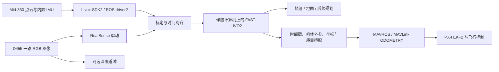

# D455 + Mid-360 + PX4 实施方案

> 用户已选择 ROS2 主路线。本文几何、同步、硬件和飞控验收要求仍适用；其中 ROS1 驱动命令与官方源码接口审查用于基准说明。ROS2 的构建、话题/参数与 PX4 接口路线见 [07](07_WSL22.04_ROS2统一环境.md)，实际字段以选定移植版本为准。

## 1. 系统分工



FAST-LIVO2 是定位建图模块。飞行还需要状态融合、控制、任务/路径规划、障碍处理和失效处置，不能把输出彩色点云直接等同于自主导航。机载应用需有独立的 Linux 伴随计算机；当前桌面 PC 可负责开发、录包和离线处理。[FAST-LIVO2 论文](https://arxiv.org/abs/2408.14035)

第一版建议只选 **Mid-360 内置 IMU** 作为 FAST-LIVO2 的惯性输入。D455 IMU 和 PX4 IMU 可记录用于诊断，但不要把三路 IMU 混发到同一个输入话题。PX4 继续用自身 IMU 控制和 EKF；雷达里程计作为外部观测输入。

D455 的 RGB 与深度传感器具有全局快门，RGB 可作为视觉输入；其深度不是本算法必要输入。初期只开一路彩色流，减少 USB 与 CPU 负担；双目联合约束、RGB-D 融合不是官方 FAST-LIVO2 默认功能。[D455 官方规格](https://www.realsenseai.com/products/real-sense-depth-camera-d455f/)

## 2. 要准备的硬件和信息

| 项目 | 准备要求 |
|---|---|
| Mid-360 | 本体、原配/兼容连接线、稳定独立供电、专用以太网连接；按当前用户手册确认电压、引脚、峰值负载 |
| D455 | USB3 数据线、可靠固定与线缆应力释放、USB3 主控与足够供电 |
| PX4 | 明确飞控板型号、固件版本、MAVLink 端口与波特率、安装朝向；保留参数和 ULog |
| 伴随计算机 | 有线网口 + USB3 + 足够 CPU/RAM/存储及散热；先以 x86 Linux 验证，再按载荷/功耗迁移 ARM |
| 安装支架 | 相机与雷达刚性固定；有足够重叠视野；不遮挡雷达，不让线缆/桨叶进入主要视野 |
| 标定 | 相机标定板、FAST-Calib 对应标定目标、卷尺/安装图、多角度静态数据和动态数据 |
| 同步 | 明确采用 PTP/时间域映射/外触发哪种方案，准备相应网卡、同步器和测量工具 |
| 验证 | 无桨台架、PX4 SITL、可控地面运动路线；飞行前检查失效处理和人工接管 |

供电预算需累加雷达、相机、伴随计算机、通信与散热的实际峰值，不能仅按平均功耗选 DC-DC。不要把电池电压直接接入未经核实的相机/同步引脚。Mid-360 当前规格与接线以 [Livox 官方产品资料](https://www.livoxtech.com/mid-360) 为准。

未知项：当前未确认用户是否已经拥有/连接设备，未读到设备序列号/固件/飞控参数；本文是实施方案，不是已完成硬件验收。

## 3. 驱动准备与最低输入合同

推荐先在原生 Linux 上做实机采集，保留 03 的容器作为离线复现基准。WSL 的 USB 转发、Docker UDP 接收和 PTP 时间戳路径需另测，本次容器通过不覆盖这些能力。

### 3.1 Mid-360

1. 安装 [Livox-SDK2](https://github.com/Livox-SDK/Livox-SDK2) 与 [livox_ros_driver2](https://github.com/Livox-SDK/livox_ros_driver2)，按其 Noetic 说明在独立 `ws_livox/src/` 构建；使用 `./build.sh ROS1`，启动 `msg_MID360.launch`。
2. 修改当前驱动自带的 `MID360_config.json`：雷达 IP 与真实设备一致，host IP 是连接雷达的网卡地址，UDP 目的端口匹配。不要把其他 SDK 版本的 JSON 原样覆盖；新旧版本字段结构可能不同。
3. 主机和雷达放在相同可达网段。例 `192.168.1.50/24` 仅是示例主机地址，先确认无冲突；不要未经检查修改目前正在联网的网卡。抓包/驱动状态比仅 ping 成功更有证明力。
4. 使用自定义点云模式 `xfer_format=1`，确认 `/livox/lidar` 和 `/livox/imu` 都在发布；记录驱动 SHA、配置和固件。

| 输入 | 预期信息 | 验证 |
|---|---|---|
| LiDAR | CustomMsg 的 xyz、reflectivity、tag、line、逐点 offset_time 与帧基准时间 | `rostopic type /livox/lidar`、`rosmsg show`、`rostopic hz`；检查时间递增 |
| IMU | 角速度、加速度及采样时间 | 静止均值、轴方向、单位/归一化路径；不要未经检查重复乘 9.81 |
| Camera | sensor_msgs/Image，稳定曝光和分辨率，精确时间 | camera_info、encoding、频率、帧号及时间域 |

**消息兼容是一个独立检查项。** 当前 FAST-LIVO2 自带 `include/livox_ros_driver/CustomMsg.h`，订阅的是旧类型；Mid-360 官方 driver2 发布 `livox_ros_driver2/CustomMsg`。ROS1 的 MD5/字段兼容行为需实测，不应仅凭包名不同断言必失败，也不能靠 topic 重命名宣称已适配。

可选做法：

- 先比较两边 `CustomMsg` 与 `CustomPoint` 的字段、序列化和 MD5，检查实际连接是否接收数据。
- 为清晰的实机工程，另建源码副本/分支，把 includes 与 `livox_ros_driver::` 类型改为 driver2，并在 CMake `find_package` / `catkin_package`、package.xml 中加入 driver2 依赖，增加生成消息目标依赖后重编译。不要修改本目录用于公开 bag 的基准快照。
- 若需要同时回放旧 bag，使用显式消息桥逐字段转发，保留全部时间/点字段；不要伪造 bag 元数据当成转换。ROS2 的 rosbag2 转换还涉及序列化与类型注册，不能只改 metadata 名称。

Mid-360 在配套配置中仍用 `lidar_type: 1` 进入 Livox CustomMsg 分支，`scan_line: 4`；它不是按产品名随便填写 `360`。配套默认内置 IMU 平移为 `[-0.011,-0.02329,0.04412] m`，可作为检查起点；必须核对使用的驱动是否已变换点云坐标。[作者团队 Mid-360 参数](https://github.com/hku-mars/LIV_handhold_2/blob/main/FAST-LIVO2-Mid360-Config/config/mid360.yaml)

### 3.2 D455

先用 RealSense Viewer / `rs-enumerate-devices` 确认 USB3、固件和可用 profile。ROS1 应使用 [ros1-legacy](https://github.com/realsenseai/realsense-ros/tree/ros1-legacy) 而非当前默认 ROS2 分支。该 legacy README 指向 librealsense v2.50.0；实际相机固件/内核组合仍需验证，不要随意把最新 SDK、旧 ROS wrapper 与任意固件混搭。

ROS1 参数示例（设备支持该 profile 时）：

```bash
roslaunch realsense2_camera rs_camera.launch \
  enable_color:=true color_width:=640 color_height:=480 color_fps:=30 \
  enable_depth:=false enable_infra1:=false enable_infra2:=false \
  enable_gyro:=false enable_accel:=false
rostopic echo -n 1 /camera/color/camera_info
rostopic hz /camera/color/image_raw
```

确认本机 legacy launch 的参数名后再用；ROS2 的 profile 参数命名不同。初始目标为 30 Hz 左右的稳定 RGB，输入 `/camera/color/image_raw`。先确认原始输出，再调曝光/增益，记录所有设置；快速运动时缩短曝光，兼顾亮度和模糊。`enable_sync` 或 `global_time_enabled` 不代表已实现相机与 Mid-360 硬件同步。

## 4. 标定：必须交付这些结果

统一约定 `T_AB` 表示把 B 坐标中的点变到 A：`p_A = R_AB p_B + t_AB`。

| 标定量 | 在本版代码中的意义 |
|---|---|
| `extrinsic_R/T` | `T_IL`，LiDAR L → 使用的 IMU I；源码计算 `p_I = extR * p_L + extT` |
| `Rcl/Pcl` | `T_CL`，LiDAR L → 相机光学坐标 C；不是反向变换 |
| 相机内参 | 与实际图像宽高、畸变模型、缩放一致的 fx/fy/cx/cy/d0… |
| `T_BI` | IMU I → 飞控定义机体 B，用于里程计输出换原点/朝向 |

若工具给出反向 `T_LC`，须整体求逆：`R_CL=R_LC^T`，`t_CL=-R_LC^T t_LC`，不能只将平移取负。

流程：固定最终安装结构 → 标定实际 RGB profile 的相机内参 → 使用 [FAST-Calib](https://github.com/hku-mars/FAST-Calib) 做雷达—相机外参 → 用未参与拟合的数据做投影叠加检验 → 测量/标定 IMU 到机体的外参 → 保存图像、配置、矩阵方向、日期和误差。

`camera_info` 可作内参起点，但 FAST-LIVO2 读取 YAML，相机信息不会自动替你写入。若输入已校正图像，使用该图像的有效投影内参和相应零畸变，不要再套原始畸变。`scale` 会影响内参/图像处理，不能既手工缩小内参又让配置再缩一次。实际从 D455 RGB 切到红外相机时必须换整套对应内外参。

建议校验目标（工程建议，非算法保证）：多距离/多角度投影无明显系统偏差；相机重投影 RMS 尽量低于约 0.5–1 px；记录达不到的原因。远距离边缘正确不代表近距离平移也正确。

## 5. 时间同步：最容易导致“静止正确、运动发散”的问题

Mid-360 的雷达/内置 IMU 共享设备侧时间体系，仍要验证驱动输出。相机、雷达、伴随计算机、飞控可能各有时钟；必须区分设备采样时刻、主机接收时刻、ROS header 和 PX4 boot time。

推荐分两级实施：

1. **低速地面原型**：记录两设备原始 timestamp/域，建立到同一主机时钟的映射，估计固定偏移，测残余抖动与随时间漂移。此阶段可以检验几何和软件链路，但不宣称硬同步。
2. **高速/机载目标**：采用经过验证的共同时间基准与触发方案。Mid-360 的 PTP/GPS 等能力参考 [Livox 时间同步文档](https://livox-wiki-en.readthedocs.io/en/latest/tutorials/new_product/mid360/mid360.html)。D455 的外同步能力必须按具体 RGB/深度流、固件和 SDK 支持逐项确认；不能把深度触发成功当作 RGB 也已锁定。[RealSense 外同步说明](https://www.realsenseai.com/news-insights/depth-camera-external-sync-trigger/)

若 D455 RGB 无法在实际固件/模式下实现所需同步精度，可以评估能验证触发的 IR 流（需关闭投射器影响并重标定、图像编码适配），或改用外触发工业相机。作者 LIV-Eye 的海康同步线路不是 D455 的通用接线模板。

本版源码对偏移的实际操作：

```text
image_corrected_time = image_header_time + img_time_offset
imu_corrected_time   = imu_header_time   - imu_time_offset
```

两者符号相反，必须按数据推导。官方 Avia/Mid-360 示例中的 `img_time_offset: 0.1` 是配套设备设置，不能复制到 D455。自动曝光估计是光度模型，不等同于自动标定任意时间漂移。

建议初期把运动段残余同步误差/抖动控制到毫秒量级，并真实测量其 P95；预算应由运动决定：例如 2 m/s 下 10 ms 产生 2 cm 位移，100°/s 下产生 1°转角。固定 offset 只能补固定偏差，不能解决随机 USB 延迟、丢帧或时钟漂移。同步验收要包含长时间运行和重启后的重复性。

## 6. 自采启动和录包

先单独跑 Mid-360 的 LIO，确认点云、IMU、外参和时间正确，再打开视觉。配置参考 `templates/mid360_d455_checklist.yaml`，其中 null 是未标定项，**该文件不是可直接加载的算法配置**。从上游 `avia.yaml` 复制一份作为实机参数基础，按核验结果修改。

建议录制（按真实存在的话题调整）：

```bash
rosbag record -O handheld_01.bag \
  /livox/lidar /livox/imu /camera/color/image_raw /camera/color/camera_info \
  /tf /tf_static /aft_mapped_to_init /LIVO2/imu_propagate
```

另外记录相机 metadata（若驱动发布）、同步诊断和 PX4 ULog。每段开头静止约 10 秒，再做平移、慢转弯、不同视角，最后回到起点。优先手持/小车测试 1–3 分钟，再扩展长时间；初始化时避免激烈运动。

## 7. 接入 PX4：必须有适配层

本资料以 [PX4 v1.16 外部定位文档](https://docs.px4.io/v1.16/en/ros/external_position_estimation) 为接口参考，**不是确认用户飞控已运行 v1.16**。实际参数及消息定义必须匹配已安装固件。

本次源码审查发现：

- `/aft_mapped_to_init` 的 pose 是状态 IMU 的位姿，frame 名为 `camera_init/aft_mapped`；发布时间戳使用 `ros::Time::now()`，没有在该函数中填充有效 twist/协方差。
- 自带 `/mavros/vision_pose/pose` 也使用当前发布时间，并没有加入本套硬件 IMU→机体外参。
- 开启 `uav/imu_rate_odom` 后 `/LIVO2/imu_propagate` 使用最新 IMU 时间戳，并给出世界系线速度；但缺少完整 child frame/协方差等飞控接口信息。定时器周期 0.004 s 不保证实测就有 250 Hz。

因此首轮应将源码内 `/mavros/vision_pose/pose` remap 到 `/fastlivo2/raw_vision_pose`，由单独适配节点处理后再发 MAVROS，避免两个发布者向飞控送重复观测。

适配层应完成：

1. **原点变换**：若输出是 `T_WI`，需机体位姿 `T_WB = T_WI * T_IB`。外参只补偿一次；若已经换到机体原点，PX4 `EKF2_EV_POS_*` 不再重复补原传感器杆臂。
2. **坐标变换**：ROS 通常以 FLU 机体、ENU/局部重力对齐世界描述；相机 optical 为右/下/前，PX4 为 FRD/NED 或局部 FRD。`camera_init` 的名字不代表自动具有 ENU 或北向；先确认重力和初始 yaw。真正 ENU→NED 的向量变换是 `[x,y,z]→[y,x,-z]`，FLU→FRD 是 `[x,y,z]→[x,-y,-z]`；姿态须同时变换父子坐标系，不能只交换四元数分量。使用 MAVROS 时确认插件/TF 已做的变换，避免再做一次。
3. **时间与有效频率**：保留状态采样时刻，完成伴随机与 FCU timesync，度量端到端延迟。目标通常按 PX4 文档取 30–50 Hz；可对有效的 IMU 传播输出限频，不能把旧 pose 重复盖新 timestamp 伪装高频。
4. **速度和不确定度**：世界系速度应转为消息要求的坐标系；换原点时考虑角速度与杆臂导致的速度项。协方差必须来自合理模型/状态传播，变换坐标时同时变换；全零不是已知完美精度。未实现可信速度就先不启用 PX4 外部速度融合。
5. **质量/失效**：检测时间倒退、NaN、失联、队列延迟、状态跳变及雷达/视觉退化。跟踪最后一次有效 LiDAR/视觉校正时刻，防止 IMU 传播仍有输出却实际已长时漂移。重定位/重启要处理 reset，不能用无效值继续推送。

ROS1 最小接入可用经过适配的 pose 发到 `/mavros/vision_pose/pose`；需要速度、协方差等时使用 MAVROS odometry 输入（通常 `/mavros/odometry/in`），确认 odometry 插件启用、frame 与 TF 合同后再用。MAVLink `ODOMETRY` / `VISION_POSITION_ESTIMATE` 是外部状态观测，不是控制 setpoint。[MAVROS 源码](https://github.com/mavlink/mavros)

ROS2 长期路线可通过 uXRCE-DDS 向 `/fmu/in/vehicle_visual_odometry` 发送匹配版本的 `VehicleOdometry`，但这要求 ROS2 算法/桥接和 PX4 消息版本配套，不能从 ROS1 `nav_msgs/Odometry` 直接原样投递。[PX4 ROS2 指南](https://docs.px4.io/v1.16/en/ros2/user_guide)

## 8. PX4 参数与台架验收

| 参数族 | 如何准备 |
|---|---|
| `EKF2_EV_CTRL` | 分别决定水平位置、垂直位置、速度、yaw 是否融合；先启用已经验证的量，不直接照抄所有位都开的数字 |
| `EKF2_HGT_REF` | 是否采用视觉作为高度参考，按实际系统传感器策略决定 |
| `EKF2_EV_DELAY` | 对照真实采样时间与 FCU 时间，结合 ULog 创新量调试；不是网络往返时间的直接替代 |
| `EKF2_EV_POS_X/Y/Z` | 观测原点相对机体的杆臂；与适配层的换原点职责一致 |
| 外部观测噪声 | 核对该版本的参数/消息协方差选择，使用测量结果而非任意极小值 |

保留气压/GNSS/测距等现有融合策略，直到完成对比测试再逐项更改。不同 PX4 版本有不同参数，不应把旧教程 `EKF2_AID_MASK` 和新版本 `EKF2_EV_CTRL` 混用。保存完整参数备份、重启后检查参数生效与融合状态。

无桨台架依次向前、向左、向上平移，再分别转 yaw/roll/pitch，确认 QGroundControl/本地状态方向一致。观察 `vehicle_visual_odometry`、`vehicle_local_position`、EKF 外部观测创新量和拒绝状态；验证断开相机、断开雷达、停止适配节点时系统按预期退出/降级。Offboard setpoint 的持续发送与外部定位是两个独立链路。

## 9. 建议里程碑

| 阶段 | 通过条件 | 产物 |
|---|---|---|
| A 公开数据 | 完整 bag 无崩溃、轨迹有效、可复查评价 | 镜像、日志、轨迹、精度表 |
| B Mid-360 LIO | 静止/手持稳定，IMU/点时间一致 | 原始 bag、配置、点云 |
| C D455 LIVO | 校准投影正确，动态无系统性彩色重影，视觉约束确实参与 | 内外参、同步误差、LIO/LIVO 对照 |
| D PX4 SITL/无桨 | 轴向、时间、频率、融合、丢失观测处理通过 | 适配代码、PX4 参数、ULog |
| E 受控低速飞行 | 接管/失效策略已验证、实时预算有余量 | 飞行日志、误差与风险记录 |

桌面环境的 1 倍速通过不能替代机载验收。伴随计算机必须在实际图像 profile、录包、通信和热负载下连续测性能；原则上处理积压不能随时间持续增长。FAST-LIVO2 仍可能发生长期漂移；需全局一致地图/回环/重定位时另行设计后端，不能把基础里程计当作永久无漂移定位。
