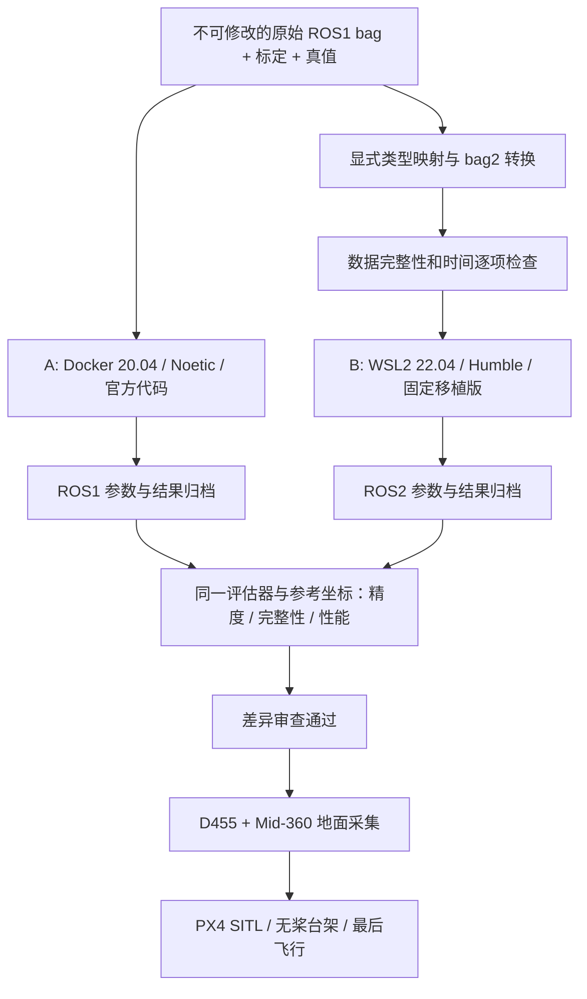

# FAST-LIVO2 双环境原版复现与 ROS2 移植验证计划

制定日期：2026-09-24。本文是用户最新确认的设计方向；优先级高于 01/03/07 中单路线建议。本文交付详细计划，本次没有执行 ROS 安装、ROS2 移植或传感器部署。

## 1. 总体决策与当前真实状态

采用 **A 环境建立官方 ROS1 基准，B 环境独立验证 ROS2 移植，最后再做真实硬件集成**。这种设计合理：能把算法原有行为、ROS2 迁移引入的差异、传感器接入问题分开定位。

需要纠正“已有 20.04”的含义：本机已安装 Docker Desktop/WSL2，已拉取并运行 `ubuntu:20.04`；这是 **Docker 镜像**。本机目前没有独立 Ubuntu 20.04 WSL 发行版，也没有 ROS1 运行环境。临时测试容器已经自动删除。新建 22.04 时不会影响这个镜像。

| 环境 | 定位 | 系统/ROS | 目前状态 |
|---|---|---|---|
| A：官方基准 | 判断数据/算法是否正确，为 ROS2 提供参照 | Docker 容器：Ubuntu 20.04 + ROS Noetic | Docker 与 Ubuntu20 容器已通过冒烟测试；ROS镜像/算法待构建 |
| B：移植验证 | 统一 ROS2 开发、bag2、RViz2、后续 PX4 仿真 | 独立 WSL2：Ubuntu 22.04 + ROS2 Humble | 发行版与 ROS2 均待安装 |
| C：实机部署 | D455 + Mid-360 + PX4 采集/闭环 | 原生 Linux 伴随计算机，先尽量对齐 B 的软件版本 | 硬件型号/固件/计算平台待确认 |

**当前执行主案不另装 Ubuntu20 WSL。** A 使用已经验证可用的 Docker 基础设施；B 才是新增的常规 WSL 发行版。若以后希望 A 也有完整 WSLg 交互，可额外创建 Ubuntu20 WSL，但它是新增环境，应重新验收，不属于“现成可用”。

本机 CPU/内存足够开展该方案；容器、WSL 共享同一台主机的算力。基准性能测试时 A/B 串行运行，避免相互竞争资源。Humble 对应 Ubuntu22.04，支持至 2027-05；Noetic 已 EOL，作为固定研究基线保留。[REP-2000](https://github.com/ros-infrastructure/rep/blob/master/rep-2000.rst)、[Noetic EOL](https://www.ros.org/blog/noetic-eol/)

## 2. 架构与目录



Windows 资料与归档全部放在：

```text
D:\_AAA_CODE_ALL\Tech_reproduction\FASTLIVO2_reproduction\
├── docs/                       计划、操作手册、接口说明
├── upstream/FAST-LIVO2/         官方 ROS1 参考快照，保持不变
├── docker/                     A 的镜像定义
├── scripts/                    检查/导出/评估辅助脚本
├── templates/                  实验与标定模板
├── evidence/                   本机环境与容器实测证据
├── data/                       执行阶段创建
│   ├── raw/<dataset>/<seq>/    原始文件、checksum、标定、真值
│   └── converted/<seq>/        bag2、转换版本、类型映射与检查报告
├── manifests/                  执行阶段创建：SHA、镜像、依赖版本
└── results/<run_id>/            执行阶段创建：参数、日志、轨迹、评价
```

B 在 Linux ext4 中使用 `~/repro/fastlivo2_ws`、`drivers_ws`、`px4_ws` 和当前数据副本。构建不放 `/mnt/d`；每次结束把 manifest、改动 patch、结果复制回本目录。A 的算法构建同样在容器 Linux 文件系统，D 盘只做输入/输出挂载。

为避免两个环境互相污染：

- A 不直接连接 B 的 ROS graph；第一阶段用离线文件对照，暂不引入 ros1_bridge。
- A/B 各自使用自己的编译缓存、Sophus/Vikit、Python 与 ROS setup；不要共享 `build/devel/install`。
- `.bashrc` 至多 source 对应发行版基础环境；项目 overlay 按需 source。
- 同一个 `fast_livo` 包名只在一个活动 overlay 中出现；对照实验更换 fork 时使用新工作区。
- Noetic 在隔离容器内，不能直接安装到 Jammy；ROS1 的 Dockerfile 不能作为 Humble 的构建脚本。

## 3. P0：确认基线与冻结输入（预计半天内，取决于下载）

### 工作

1. 以 `evidence/host_inventory.json` 为初始机器记录，再采集一次 Docker/WSL 版本和资源配额。
2. 官方代码固定为 `0d2c0346107b75b59934975adec9a6eeeb913c64`。保留上游原样，所有需要的启动包装与兼容改动放外部文件或独立分支。
3. 第一批只选 **1 个官方短序列** 跑通，例如实际可下载的 Retail_Street；第二批选 **1 个有合适真值的序列**。NTU VIRAL 或 Hilti 是否作为 ROS2 对照取决于候选 fork 的 Ouster/Hesai 分支是否完整，不能先假设已支持。
4. 每个原始 bag、标定与真值保存源链接、文件字节数、SHA256、取得时间。原始数据只读；重命名/解压/裁剪/转换均产生新文件。
5. 建立两个评估目标：
   - 运行一致性：节点、输入、参数和轨迹输出是否合理；
   - 数值/性能：与真值或固定 ROS1 基线比较，按下面 G3/G4 判据验收。

### G0 验收

文件校验和、来源、源码 SHA、配置名称明确；短序列包含 LiDAR/IMU/图像的有效重叠时间段。真值若不存在必须标记，不得把 ROS1 输出冒充真值。

### 失败处理

网盘不可访问就切换同作者可用入口/已配套序列，不下载不明格式的二次处理数据冒充原始数据。网络失败与算法失败分别记录；当前已发生过 GitHub 连接重置/API 限流，不能把网络下载步骤视为必定成功。

## 4. P1：A 环境官方 ROS1 原版复现（预计 1–2 个工作日）

### 工作

1. 根据 [03 手册](03_本地复现操作手册.md) 构建 `fastlivo2:noetic-local`。固定 Noetic 基础镜像 digest、apt 包版本清单、Sophus/Vikit 提交、编译参数。现有 Dockerfile 是起点，未通过构建前不能称作已验证镜像。
2. 首轮无 RViz、无 PCD 全量保存，以 `-j4` 限制编译内存。公开 bag 不需要真实 Livox/D455 驱动；官方代码含对应 Livox 消息头。
3. 用 `rosbag info` 检查话题；先 0.5 倍速排除 CPU/解压积压，再 1 倍速运行。启用 `/clock` 与 `use_sim_time`；静止初始化和起播时间按数据集配置处理。
4. 明确图像 raw/compressed 路径，不出现两个同名 raw 发布者。记录启动日志、输入/输出数量、轨迹、参数、处理时间和峰值内存。
5. 使用固定 `seq_name` 对应独立运行目录，正常关闭节点后复制 `Log/result/*.txt`。官方部分 ROS 话题使用发布时间，评估优先使用算法记录的状态时刻轨迹；审查 VIO/LIO 输出时刻区别。
6. 同配置完整运行 **3 次**，观察基线自身差异；进行一次 `img_en=0` 的 LIO 对照，確認 LIVO 并非只接收图像却没有视觉更新。

### G1 验收

- 构建日志无失败包，`fast_livo` 能启动；完整短序列退出正常。
- 初始化之后有连续有效轨迹，数值有限、四元数归一化合理，无持续同步/消息类型错误。
- 输出起止时间覆盖应处理的数据段；排除初始化耗时后，建议有效覆盖率至少 99%，任何断段须解释。此数值是本项目预设验收门槛，不是论文保证。
- 3 次结果的差异、运行时波动已量化；地图/轨迹可人工复查。
- 1 倍速时处理积压不持续增长。没有满足该项时可以宣布“离线跑通”，不能宣布“实时通过”。

### 固化产物

`A-baseline` 镜像 ID/导出包（按需）、官方 SHA、依赖清单、启动包装、参数快照、3 次轨迹/日志、初始评估表。对基准镜像打固定本地 tag，后续不在其中装 ROS2 或升级库。

## 5. P2：新建 B 环境 Ubuntu22.04/Humble（预计半天至 1 天）

此阶段可与 A 的下载准备交错进行，但不应同时跑性能测试。具体安装步骤见 [07](07_WSL22.04_ROS2统一环境.md)。

### 工作

1. `wsl --install -d Ubuntu-22.04`，确认 `wsl -l -v` 列出独立发行版且为 WSL2。按需规划发行版虚拟磁盘放 D 盘；若本机安装工具不支持指定位置，使用微软正式导入/迁移流程，不手工搬运行中的 VHDX。
2. 安装 ROS2 Humble desktop、colcon、rosdep、vcstool、Git、编译工具和 Python venv。按当前官方 apt 源/key 步骤安装，不复制过期源命令。
3. 验证 `ros2 doctor`、talker/listener、`rviz2`，记录 `ROS_DISTRO=humble`、系统 Python3.10 和软件包清单。
4. 创建独立 workspaces；Docker Desktop 若需要在 B 的终端使用，可启用其 WSL integration。不要再在 B 中随意部署第二套 dockerd，造成两个 Docker daemon 和镜像库混淆。
5. 先保留当前资源设置，以 `-j4` 构建。只有确实内存不足时再调整 WSL 全局上限；改 `.wslconfig` 前备份，明确会影响 Docker 的共享 VM 资源。
6. 基础环境通过后做 WSL 导出快照；导出/停止发行版应安排在无运行实验的时段。保留恢复说明，不使用 unregister 做日常“清理”。

### G2 验收

独立 Ubuntu22.04 启动正常，Humble CLI/通信/GUI通过；不包含 Noetic source 或 Windows Anaconda 路径污染。能从 `/mnt/d/.../data` 读取数据并将结果写回指定目录。导出快照和依赖清单可定位。

## 6. P3：审查并锁定 ROS2 移植版（预计 1–3 个工作日）

### 选择策略

优先审查 [Robotic-Developer-Road/FAST-LIVO2 的 humble 分支](https://github.com/Robotic-Developer-Road/FAST-LIVO2/tree/humble)，其 CMake 已确认使用 ament/rclcpp/driver2。配套 Vikit 使用该移植指定版本。以 [DeepRoboticsLab 集成工程](https://github.com/DeepRoboticsLab/fast-livo2-deep-robotics) 作为 Mid-360/RealSense 接入参考，不同时混用两者参数文件。

本次只完成候选的部分静态检查，未获得完整锁定提交、未编译。实施时必须记录 FAST-LIVO2、Vikit、Livox-SDK2、driver2 的确切 SHA；fork 名称不能代替版本。

### 审查清单

| 审查项 | 需要回答的问题 |
|---|---|
| 算法与来源 | 与官方哪次提交接近？是否修改状态、残差、滤波噪声、地图结构或默认参数？ |
| 依赖 API | Sophus 模板/非模板版本是否匹配实际代码？Vikit 是否为 ROS2 版本？ |
| ROS2 参数 | 节点名、ros__parameters 嵌套、camera 参数注入是否正确？是否有“加载成功但未使用”的参数？ |
| 时间 | 图像/IMU 偏移符号、use_sim_time、now() 与传感器采样时刻、首次时间处理有无变化？ |
| 数据类型 | driver2 CustomMsg/CustomPoint、点时间单位、scan line、图像编码与压缩路径是否一致？ |
| 执行器 | 单/多线程 executor、callback group、队列锁与 IMU 传播有无竞态或丢数据？ |
| QoS | 发布/订阅可靠性与 history depth 是否匹配，回放会不会丢帧或无连接？ |
| 输出 | pose 所在原点/坐标系、twist、协方差、输出时刻是否具有清晰定义？ |
| 数据集 | Avia/Ouster/Hesai 各处理分支和相机模型是否确实移植，而非仅保留配置文件？ |

### 构建与验收

按 07 在独立 drivers_ws 构建 driver2，再构建 fastlivo2_ws。不要使用 `--continue-on-error` 掩盖失败。补丁分两类记录：平台兼容/接口修改、算法行为修改；对照阶段尽量只允许前者，必要算法差异必须在结果中列明。

G3a：编译通过、启动与参数导出正常、能消费一小段真实转换数据。输出量/时间/字段正确，且候选锁定 SHA + diff 已存档。若问题主要是候选质量而不是普通依赖错误，切换另一个干净工作区评估备选，并保留失败原因。

## 7. P4：建立可审计的 ROS1 → ROS2 数据转换（预计 1–2 个工作日）

**这一步是数值对照的前置条件，不能仅以 `ros2 bag play` 能启动验收。**

### 操作设计

1. 使用单独 venv 中固定版本的 [rosbags](https://gitlab.com/ternaris/rosbags)；保存 `pip freeze` 与转换命令。
2. 从原 ROS1 bag 的连接信息读取真实消息定义，为 Livox CustomMsg/CustomPoint 注册类型，显式定义到 driver2 ROS2 类型的映射。使用真实字段转换/序列化，输出新的 rosbag2 目录。
3. 保留原始 header stamp、bag 记录时间、点 offset/timebase 和数组次序；如果为算法修复某种历史时间字段，另建派生数据集并记录变换公式。
4. 不只编辑 metadata；数据库内连接类型、metadata、序列化定义必须一致。不要为通过订阅检查而删除点时间字段或改用无时间的普通 XYZ 点云。
5. 对原始与转换后的数据做语义统计/抽样比对；不同 ROS 版本序列化字节不同，不能要求整个文件 checksum 相同。

### G3b：转换验收矩阵

| 项目 | 判据 |
|---|---|
| 话题/类型 | 输入所需流齐全，源→目标映射明确，无意外多余/缺失流 |
| 消息数量 | 不过滤/不重采样时各 topic 数量完全一致；任何改变有记录 |
| 时间 | 每流起止时间、递增性、header与record时间关系一致；精度损失记录，目标保持纳秒时间语义 |
| 点云 | 每帧点数一致；随机抽至少 20 帧及首尾帧，比 xyz/reflectivity/tag/line/offset_time/timebase |
| IMU | 首尾与随机样本的向量、单位和时间一致；不重复换单位或轴 |
| 图像 | 原样保留 compressed 时数据内容一致；若解码则图像尺寸/encoding/像素输出一致且另行记录 |
| 相机参数 | 使用同一原始标定，不因切换 ROS 改用默认 D455 参数 |
| 实际订阅 | 目标消息能解码并进入回调；`ros2 topic info -v` 确认 QoS 相容 |

归档转换检查报告及脚本。首批只转换短序列，G3b 通过后才批量转换。

## 8. P5：ROS1 与 ROS2 对照实验（预计 2–4 个工作日）

### 对照条件

- 相同原始数据、相同有效起止区间和初始化条件。
- 相同相机模型/分辨率、外参、时间偏移、地图参数、滤波参数、视觉开关和保存策略。导出为一张“语义参数映射表”，不能只凭两个 YAML 看起来相似。
- 单机依次运行；关闭无关负载。首轮不启用 GUI，不保存全量点云；再单独做带 GUI/录包的实际工作负载测试。
- 每个条件运行 3 次，保存 run_id；不能挑最好的一次代表性能。
- 使用同一评估程序版本、真值参考原点、时间关联阈值和对齐方法。公制系统不随意做尺度拟合。

### 最小实验表

| 编号 | 内容 | 要解决的问题 |
|---|---|---|
| E1 | 官方短序列，A/B，0.5 倍速 LIVO | 去掉算力干扰后是否数值/输入一致 |
| E2 | 同序列，A/B，1 倍速 LIVO | 调度/QoS/解压是否导致积压与丢失 |
| E3 | 同序列，A/B，1 倍速 LIO | 差异是否来自视觉参数/图像同步 |
| E4 | 第二个具真值且两边支持的序列 | 能否跨序列稳定复现而非单包偶然成功 |
| E5 | 较长序列或重复分段运行 | 内存增长、状态初始化和长时稳定性 |

### 指标与预设门槛

以下是本项目建议的初始工程门槛，实施前固定到实验配置，不能看到结果后任意调整；不是官方性能承诺。

| 维度 | 报告内容 | 建议验收规则 |
|---|---|---|
| 完整性 | 初始化后轨迹覆盖率、最长断段、退出原因 | 有效覆盖率 ≥99%，无未解释崩溃/同步错误/明显时间倒退 |
| 有真值精度 | ATE RMSE、RPE、关联数量/覆盖率 | B 的 ATE 相比 A 增量不超过 `max(基线ATE×5%, 0.02 m, 基线3次波动幅度)`，超出就调查；阈值还须适配真值精度/场景尺度 |
| 无真值一致性 | A/B 同参考原点且时间对齐后的轨迹差异、终点差、地图叠合 | 只称一致性，不称真实定位精度；阈值先根据 A 自身波动和任务容差冻结 |
| 相对运动 | 相同距离/时间间隔的平移/旋转 RPE | 不出现明显系统性轴向/尺度/角速度差异；姿态真值不足时不报告姿态精度 |
| 实时性 | 输入积压趋势、处理时间 P50/P95、墙钟运行比 | 1 倍速不持续积压，端到端完成时间与数据时长相容；按真实处理单元频率设时延预算 |
| 性能回归 | A/B 相同负载下 CPU、峰值 RSS、运行时 | 超过约20%的变化触发分析，不直接归因算法；Docker与WSL路径/ROS开销会影响结果 |
| 可重复性 | 3 次指标范围 | 不出现单次突然失效；异常运行保留并定位，不从统计中悄悄剔除 |

ATE门槛示例用于筛查迁移差异，不能同时替代应用精度指标；例如机载悬停可能有更严格局部误差要求。Hilti 稀疏位置真值使用发布方评价方法，不能套用连续完整位姿评价。

### 性能测量注意

ROS `/clock` 是仿真时间，不能用 `wall_now - bag_header_stamp` 计算旧数据集的处理延迟。应用单调墙钟测 callback/处理耗时，记录与当前回放 `/clock` 的相对滞后和队列趋势；真机使用同一时间域下采样时刻到输出时刻的延迟。区分算法处理时间、图像解压时间和整链路延迟。

### G4 决策

- 数据、参数、输出时刻审查通过，E1–E4 达到预设门槛：可称“ROS2 移植在所测序列上通过对照验证”。
- 只有编译和地图显示成功：只称“ROS2 跑通”，不得宣称精度复现。
- B 比 A 更好但算法/默认参数不同：记录为改进/变体结果，不据此宣称纯移植等价。
- 差异超门槛：按“数据转换 → 参数/相机模型 → 时间/坐标 → QoS/线程 → 算法变更”顺序排查；A 固定不动。

## 9. P6：D455 + Mid-360 硬件验证（预计 3–7 个工作日，取决于同步/标定）

G4 通过后才进入硬件主线，详细方案见 [04](04_D455_Mid360_PX4实施方案.md)。

1. 建立原生 Linux 采集环境，或先在 WSL 做非闭环实验；确认 USB3 与雷达 UDP 确实连续可用。
2. Mid-360 点云 + 内置 IMU 跑通 LIO；D455 只开所需一路 RGB，暂不增加深度/双目/第二IMU融合。
3. 固定最终支架，标定相机内参、LiDAR→相机、LiDAR→IMU、IMU→机体；保存方向定义和米/弧度单位。
4. 验证时间域、固定偏移、抖动/漂移与重启重复性；需要高速运动时采用已验证的触发/统一时间方案。D455 深度同步不自动等于 RGB 同步。
5. 采集静止、平移、旋转、弱纹理、不同曝光等短包；先离线回放再实时运行，保留 raw bag2。可用时将同一传感器语义数据送 A 交叉检查，转换需重新验收。
6. 在目标机载算力/散热/供电条件下做长时间负载测试；桌面 i7 的结果不替代机载平台。

G5：数据稳定、标定投影合理、时间残差已测量、LIO/LIVO 均无未解释的动态发散；输出机体位姿与有效状态时刻有完整定义，质量失效能被检测。没有这些证据不进入真实飞控控制闭环。

## 10. P7：PX4 仿真、台架与应用验证（预计另 3–7 个工作日）

1. 固定飞控板/固件/px4_msgs 或 MAVROS2 版本；优先 ROS2 uXRCE-DDS 原生链路，若使用 MAVROS2 则固定插件和TF约定。两种链路不要同时推送同一观测。
2. 实现里程计适配层：观测原点、ENU/FLU/局部世界到 PX4 坐标、采样时刻/FCU时间、速度与杆臂、方差、reset_counter和失效门控。
3. PX4 SITL 验证消息字段和外部观测融合；使用模拟运动/受控轨迹验证轴向，不把任意公开 bag 的轨迹与无关仿真机体运动强行融合。
4. 无桨台架进行前/左/上移动与三轴旋转，核查外部观测、PX4本地状态、创新量和拒绝状态。
5. 故障测试：断相机、断雷达、停止校正但IMU仍传播、丢包/延迟、里程计重启、伴随机重启；确认不会把过期/错误状态持续伪装成新测量。
6. 完成参数备份、人工接管和状态失效策略验收后，再逐步进入受控低速飞行。外部定位和 Offboard setpoint 链路分别验收。

G6：SITL/台架方向与时间正确、外部观测稳定融合、失效处理通过；飞行资格来自整机验收，不由“某算法开源示例跑通”推出。[PX4 外部定位](https://docs.px4.io/v1.16/en/ros/external_position_estimation)、[PX4 ROS2](https://docs.px4.io/v1.16/en/ros2/user_guide)

## 11. 风险与回退

| 风险 | 识别办法 | 回退措施 |
|---|---|---|
| Noetic apt/镜像老化 | 构建日志/官方源校验 | 固定已通过镜像并归档，更新依赖变更记录，不关闭签名校验 |
| GitHub/网盘网络失败 | 连接日志、来源/校验和 | 保留已下载资料，重试官方渠道；不把半包当完整数据 |
| ROS2 fork质量/维护不明 | SHA/diff、问题复现与参数审查 | 新workspace评估备选，A基准保持不变 |
| CustomMsg 转换失真 | G3b逐字段检查 | 重做转换，不通过改元数据掩盖字段问题 |
| 资源互相抢占 | 同时进程/WSL配额/内存峰值 | A/B串行测，降低构建并行，必要时调整全局资源 |
| WSL USB/UDP/PTP限制 | 丢帧、网络抓包、时间残差 | WSL保留离线用途，采集与闭环迁原生Linux |
| 环境升级污染结果 | manifests差异 | 恢复镜像/WSL快照或新建环境，保留结果可追溯性 |
| 无真值却声称高精度 | 评估表中的真值列 | 明确报告一致性/返回误差，增加可靠真值后再做精度结论 |

## 12. 执行优先级与最终交付

**第一轮只执行 P0–P2：A 跑通官方短序列、B 建好 Humble 基础。** 这能较快形成一个可靠可用的基准和一个干净的迁移平台，避免一开始同时处理bag转换、移植和飞控。

第二轮 P3–P5 产出锁定的 ROS2 版本、可靠转换工具和对照报告；第三轮 P6–P7 才接入最终传感器/飞控。上述耗时是人工工作量估计，网络下载、驱动问题、标定条件与硬件就绪程度都会改变进度，不是完成日期承诺。

最终交付清单：

- A 可恢复镜像 + 官方代码 SHA + 所有兼容补丁。
- B WSL/Humble 基线快照 + 精确 repos manifest + 移植补丁。
- 原始与转换数据的校验和、类型映射、转换完整性报告。
- 至少两个适用序列的参数映射、轨迹、精度/完整性/性能对照。
- 自采硬件标定、同步报告、驱动/固件版本和原始记录。
- PX4适配层、参数备份、SITL/台架测试结果及失效处理说明。

当前已完成的是环境检查、源码审查和方案/模板准备。上述执行产物不应被理解为本次已经安装或已经测试通过。
