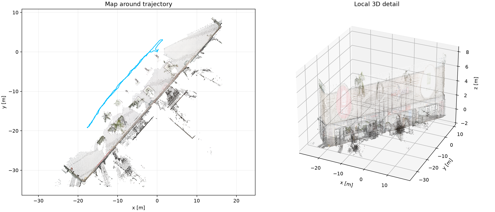
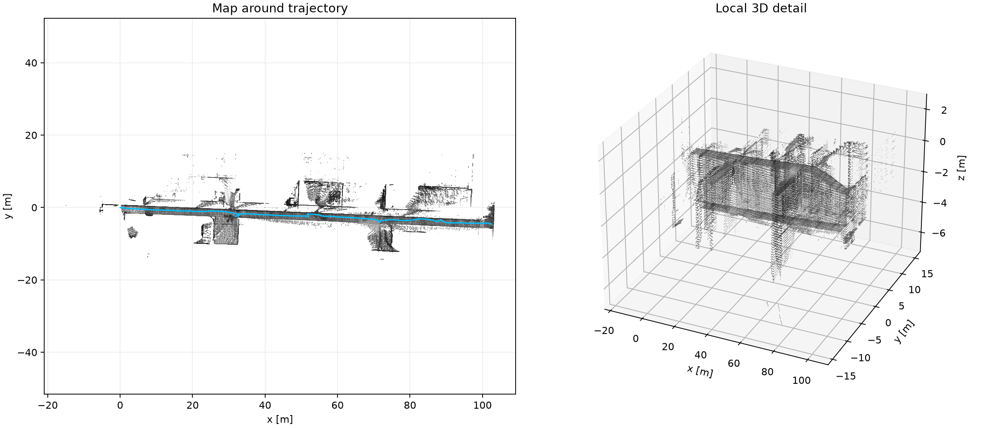

# FAST-LIVO2：ROS1 原版与 ROS2 移植的多数据集成果

更新时间：2026-09-24。所有数值由此目录中的原始数据、轨迹、程序日志和脚本重新计算。视频是以原数据 **1×** 回放时采集的真实算法输出，画面在回放后编码；这是时间同步的回放展示，不是飞行或相机屏幕录像。

## 结论与论文对齐范围

- Retail_Street 在无真值条件下，ROS1/ROS2 固定尺度 SE(3) 对齐后的轨迹差异 RMSE 为 **1.08 cm**；3 次独立运行的 ROS1 与 ROS2 内部差异均值分别为 **0.41 cm** 和 **0.44 cm**。这是实现一致性，不是定位误差。
- Hilti Exp14 具有连续 6DoF IMU 真值，线性位置/球面姿态插值到估计时刻后，ROS1/ROS2 ATE RMSE 为 **3.83/3.85 cm**。Exp14 不在论文表 II 的那组序列中。
- 新增 Hilti Exp18（corridor lower gallery 2，连续 6DoF IMU 真值，1×）：ROS1/ROS2 ATE RMSE 为 **24.57/12.38 cm**，两版轨迹差异 RMSE **24.14 cm**。该序列各做两次独立运行：ROS1 24.57/23.38 cm、ROS2 12.38/15.06 cm；同实现重复运行差异 15.21/15.63 cm，与跨实现差异同量级，因此本序列上的实现差异不能与运行间方差分开。该序列的漂移显著大于 Exp14（同一套发布配置、同一评测口径），说明本版本精度随场景变化明显，不能用单序列代表整体。真值只覆盖前 86.6 s，GT 结束后的估计段无法评分。
- 对插值后的相同时间对，另用独立的 [evo](https://github.com/MichaelGrupp/evo) `evo_ape tum --align --pose_relation trans_part` 复核，ROS1/ROS2 RMSE 分别为 **0.038335/0.038480 m**，与本地评估器在显示精度内一致；详细 `evo_ape.zip` 与匹配TUM在 `results/comparisons/final_hilti_ros*_dense_gt/`。
- Exp18 的 ATE 同样由 evo 独立复核（两版 `rmse` 与本地评估器一致）；另以 ±0.5 s、20 ms 步长扫描估计时刻偏移，最小值出现在 **−0.02 s**（ROS1 ATE 24.54 cm，与 0 偏移的 24.57 cm 相差 <0.05 cm），说明该误差不是时钟错位造成的；明细见 `results/comparisons/exp18_ros1_shift_scan.json`。
- 论文表 II 包含 Hilti’22 **Long Corridor**。本机在发布配置、无展示录制负载的 1× 回放中，两版轨迹差异 RMSE 为 **0.67 cm**。该序列公开真值只有 6 个稀疏位置点；下表的本机位置误差采用另一套离线关联与对齐流程，不能把它与论文经官方评测流程取得的 6.7 cm 直接判成“复现成功/失败”。

论文方法、表 II 和表 III：[FAST-LIVO2 原论文](https://arxiv.org/html/2408.14035)。论文默认启用曝光估计、关闭法向细化；LiDAR 先 1:3 时间抽样，并针对 Hesai 给出 0.001 m 深度噪声及 0.001° 角度噪声，测试机为 i7-10700K/32 GB。当前官方代码的 Hilti YAML 与这些文字参数不同，因此同时保留“代码发布配置”和[论文文字参数实验清单](../configs/experiments/paper_setting_diff.json)。

## 数据、真值和转换核验

| 数据 | 时长 | LiDAR / 图像 / IMU | 真值和指标边界 |
|---|---:|---:|---|
| FAST-LIVO2 Retail_Street | 135.47 s | 1,355 / 1,355 / 27,447 | 无公开真值；只做轨迹一致性与彩色地图展示 |
| Hilti Exp14 Basement 2 | 74.01 s | 740 / 2,960 / 29,539 | 连续 6DoF IMU 真值，可计算 ATE/RPE |
| Hilti Exp07 Long Corridor | 132.26 s | 1,322 / 5,288 / 52,757 | 仅 6 个稀疏位置点，四元数是占位值；可算稀疏位置误差，不能算姿态真值 RPE |
| Hilti Exp18 Corridor Lower Gallery 2 | 109.40 s | 1,094 / 4,376 / 43,656 | 连续 6DoF IMU 真值，但只覆盖前 86.6 s；GT 结束后的估计段不参与 ATE |

Retail 来自[公开 ROS2 镜像](https://github.com/DeepRoboticsLab/fast-livo2-deep-robotics#3-run-fast-livo2-through-ros2-bag)：官方原始 ROS1 下载触发网盘限额，镜像无法与原文件 checksum 直接核对。30,157 条消息逐一完成 CDR→ROS1→CDR 字节往返校验。Hilti 的[Exp14 原包](https://huggingface.co/datasets/Hilti-Research/hilti-slam-challenge-2022/blob/main/rosbags/exp14_basement_2.bag)、[Exp07 原包](https://huggingface.co/datasets/Hilti-Research/hilti-slam-challenge-2022/blob/main/rosbags/exp07_long_corridor.bag)与[Exp18 原包](https://huggingface.co/datasets/Hilti-Research/hilti-slam-challenge-2022/blob/main/rosbags/exp18_corridor_lower_gallery_2.bag)均通过发布方 SHA256 校验（Exp18 的 `lfs.oid` 与下载后校验值一致，见 `manifests/data_checksums.json`）；相同的 cam0/IMU/Hesai 三流分别写入两种 ROS 包，非 Header.seq 字段往返一致。审核见 `results/retail_conversion_audit.json`、`results/hilti_exp14_conversion_audit.json`、`results/hilti_exp07_conversion_audit.json`、`results/hilti_exp18_conversion_audit.json`。

### 绝对位置误差与实现差异

| 场景与设置 | ROS1 ATE/稀疏位置 RMSE | ROS2 ATE/稀疏位置 RMSE | 两版轨迹差异 RMSE | 对齐与支持样本 |
|---|---:|---:|---:|---|
| Hilti Exp14，发布配置，1× | 3.83 cm | 3.85 cm | 1.34 cm | 连续真值线性/SLERP插值；ROS1 677、ROS2 675 帧 |
| Hilti Exp18，发布配置，1× | 24.57 cm | 12.38 cm | 24.14 cm | 连续真值（覆盖前 86.6 s）；ROS1 807、ROS2 807 帧 |
| Hilti Exp07，发布配置，1× | 6.97 cm | 6.93 cm | 0.67 cm | 6 个稀疏位置点，估计轨迹插值至真值时刻 |
| Hilti Exp07，直接套用全部论文文字参数，1× | **发散，排除**（轨迹最大半径 35667 m） | **发散，排除**（423 m） | — | 当前开源版本与论文文字设置无法直接数值复现；不能把输出放入ATE排行榜 |
| Hilti Exp07，论文配置纯 LIO，1× | 7.56 cm | 7.63 cm | 0.45 cm | 图像关闭，其他实验设置固定 |

Exp14 的逐项误差（连续真值区间，尺度固定）：

| 系统 | ATE RMSE / 中位 / P95 / 最大 | 1秒平移RPE RMSE | 1秒旋转RPE RMSE | 有真值覆盖的估计帧 |
|---|---:|---:|---:|---:|
| ROS1 | 3.83 / 2.40 / 5.42 / 15.40 cm | 2.13 cm | 0.38° | 677/738 (91.7%) |
| ROS2 | 3.85 / 3.17 / 5.61 / 15.02 cm | 2.09 cm | 0.58° | 675/736 (91.7%) |

Exp18 的逐项误差（同一评测口径；真值覆盖前 86.6 s，之后无参考）：

| 系统 | ATE RMSE / 中位 / P95 / 最大 | 1秒平移RPE RMSE | 1秒旋转RPE RMSE | 有真值覆盖的估计帧 |
|---|---:|---:|---:|---:|
| ROS1 | 24.57 / 22.34 / 50.93 / 53.47 cm | 3.19 cm | 0.71° | 807/1092 (73.9%) |
| ROS2 | 12.38 / 9.05 / 21.91 / 24.92 cm | 3.38 cm | 0.68° | 807/1092 (73.9%) |

Exp18 的误差随时间缓慢起伏（最大 53 cm，出现在起始段），轨迹形状与真值一致但存在系统性偏移，属于无回环里程计的漂移与初始化差异；本序列对初始段尤其敏感，因此下面同时列出两次独立运行的结果，而不是只给一个数字。

两次独立运行（ROS1 `exp18_ros1_1x_01`/`exp18_ros1_1x_04`，ROS2 `exp18_ros2_1x_02`/`exp18_ros2_1x_04`）的 ATE RMSE 为 ROS1 **24.57/23.38 cm**、ROS2 **12.38/15.06 cm**。

| 对比 | 轨迹差异 RMSE |
|---|---:|
| ROS1 两次运行之间（`exp18_ros1_1x_04`） | 15.21 cm |
| ROS2 两次运行之间（`exp18_ros2_1x_04`） | 15.63 cm |
| ROS1 第1次 vs ROS2 第1次 | 24.14 cm |
| ROS1 第2次 vs ROS2 第1次 | 18.66 cm |
| ROS1 第2次 vs ROS2 第2次 | 14.61 cm |

同实现重复运行之间的差异为 15.21 cm（ROS1）与 15.63 cm（ROS2），跨实现差异落在 14.61–24.14 cm，两者同量级。因此本序列上 ROS2 的 ATE 低于 ROS1（12.38–15.06 cm 对 24.57–23.38 cm）**不能单独归因于移植**：该序列自身的运行间方差就有十几厘米，两个实现都远差于 Exp14，需要更多重复运行或更长序列才能把“实现差异”与“单次初始化差异”分开。

未关联帧处于真值缺失区间或初始化边缘，ATE仅在可关联的时刻计算。Exp07六点稀疏真值不能提供可比的连续RPE或姿态误差。

Exp07 的 6 个真值位置几乎沿一条线分布，最小与最大中心化奇异值之比约 **0.0073**。仅 6 点拟合 SE(3) 会受取点和几何退化影响。论文表 II 的 Long Corridor 给出的官方评测结果为 **FAST-LIVO2 0.067 m、其 LIO 0.061 m、FAST-LIO2 0.064 m、FAST-LIVO 0.065 m**；这些是[论文报告值](https://arxiv.org/html/2408.14035)，此处没有在本机重跑后三种其他算法。官方评分本身是提交制：[Hilti 评测系统仓库](https://github.com/Hilti-Research/hilti-challenge-submit)只提供提交门户与分数回写，实际评分在 AWS 侧执行、评分代码未公开（2026-09-24 核查），因此本机无法复算论文的 0.067 m，本页 6 点误差只是辅助口径。

全套论文文字参数导致视觉融合不稳定，但同一组雷达参数下关闭图像后的 ROS1/ROS2 LIO 都稳定运行。`configs/experiments/` 中逐项恢复视觉参数的对照数据用于定位差异；正文只把通过物理轨迹检查的运行计入精度统计。

### 处理耗时、内存与回放

下表使用**不保存全量地图/展示点云**的 1×完整回放，排除了初始化前无效轨迹；LIO/VIO 是源码逐帧打印的计算时间均值和各自 P95，内存是算法进程 RSS 峰值。相机/雷达输入为约10 Hz 对齐处理，Hilti 原相机40 Hz按官方代码每4帧取1帧。展示运行的录制耗时另存，不混进本表。

| 场景 | 系统 | LiDAR 均值 / P95 ms | 图像均值 / P95 ms | 均值合计 ms | RSS峰值 MiB | 包时长 / 播放墙钟 s |
|---|---|---:|---:|---:|---:|---:|
| Retail | ROS1 | 23.84 / 36.72 | 7.98 / 14.14 | 31.82 | 828 | 135.5 / 144.3 |
| Retail | ROS2 | 24.90 / 36.69 | 7.41 / 13.33 | 32.31 | 793 | 135.5 / 138.3 |
| Hilti Exp14 | ROS1 | 16.08 / 33.00 | 4.04 / 5.87 | 20.12 | 995 | 74.0 / 79.1 |
| Hilti Exp14 | ROS2 | 18.08 / 36.51 | 3.99 / 6.81 | 22.06 | 968 | 74.0 / 77.2 |
| Hilti Exp18 | ROS1 | 47.24 / 128.19 | 8.46 / 15.27 | 55.70 | 2904 | 109.4 / 114.2 |
| Hilti Exp18 | ROS2 | 33.88 / 91.02 | 5.72 / 9.93 | 39.60 | 3658 | 109.4 / 112.1 |
| Hilti Exp07 发布配置 | ROS1 | 14.65 / 24.56 | 3.61 / 5.53 | 18.26 | 1753 | 132.3 / 135.2 |
| Hilti Exp07 发布配置 | ROS2 | 16.43 / 26.32 | 3.62 / 6.48 | 20.05 | 1793 | 132.3 / 135.2 |
| Hilti Exp07 论文配置纯 LIO | ROS1 | 10.98 / 18.20 | — / — | 10.98 | 1045 | 132.3 / 135.2 |
| Hilti Exp07 论文配置纯 LIO | ROS2 | 11.61 / 18.36 | — / — | 11.61 | 953 | 132.3 / 135.2 |

论文表 III 中 Long Corridor 在 i7-10700K 上的 FAST-LIVO2 报告值为 **41.42 ms（LiDAR 26.21 ms + 图像 15.21 ms）**，ARM 报告值为 94.33 ms；本机是 i7-14700K，ROS1 在 Docker、ROS2 在 WSL2，CPU/容器与参数条件不同，上表为本机可复查结果，不把更短的数字解释为算法提速比例。播放墙钟包括 ROS graph 发现、明确的约2 s播放延迟和收尾，不能当单帧端到端延迟。

输入速率检查：Retail 0.5×回放 ROS1/ROS2 有效轨迹 1351/1352 帧，1×为 1350/1352 帧；Hilti Exp14 0.5×对真值的 ROS1/ROS2 ATE 为 3.57/3.73 cm，1×为 3.83/3.85 cm。回放速度变化没有被隐去，原始逐运行内存与墙钟见 `results/aggregated/runs.csv`。

### 视觉参数逐项敏感性

固定论文文字中的雷达参数，只恢复仓库配置中的视觉因素。下列本地6点误差用于诊断参数对结果的影响；“轨迹有限”仅指未触发物理合理性守卫，不等于达到论文精度。失败运行保留日志与TUM，不纳入上面的ATE表。

| 恢复的视觉设置 | ROS1 | ROS2 |
|---|---:|---:|
| 三项全部恢复：光度噪声1000、法向开、光线投射关 | 轨迹有限；34.39 cm | 轨迹有限；29.25 cm |
| 仅光度噪声1000 | 轨迹有限；3.25 m | 轨迹有限；68.20 cm |
| 仅法向开 | 发散/失败：最大半径4481m | 轨迹有限；16.10 m |
| 仅光线投射关 | 发散/失败：最大半径2150m | 轨迹有限；80.73 cm |

视觉因素单独恢复有可能只消除极端发散，却仍有分米或米级漂移：ROS2 单独恢复法向、单独关闭光线投射后的6点误差为 16.10 m 与 80.73 cm，而同样的设置下 ROS1 轨迹发散（最大半径 4481 m / 2150 m）。两个实现对这些参数都敏感，ROS1 原版更早失去稳定性。完整 YAML、运行日志及退出状态见 `configs/experiments/`、`results/runs/` 与 `results/aggregated/excluded_runs.json`。

### LiDAR 参数的单因素分解（摘要）

论文正文对 LiDAR 也给出与仓库默认不同的数值。这里固定视觉为论文值，只把其中一个 LiDAR 键改回论文值，序列为 Hilti Exp07（6 点稀疏真值）、1×；完整说明与逐次状态见 `evidence/lidar_ablation_summary.md`，键值对照见 `configs/experiments/lidar_ablation_manifest.json`。

| 恢复的 LiDAR 设置（论文值 ← 发布值） | ROS1 | ROS2 |
|---|---|---|
| 深度/角度噪声 `dept_err 0.001 ← 0.02`、`beam_err 0.001 ← 0.05` | 稀疏误差 4.02 m | 稀疏误差 2.48 m |
| 体素/层数 `voxel_size 0.5 ← 0.4`、`max_layer 3 ← 2` | 发散/失败：最大半径1380 m | 稀疏误差 19.42 m |
| 点抽样 `point_filter_num 3 ← 1` | 稀疏误差 2.32 m | 稀疏误差 1.06 m |

发布配置在同样六点上的误差是 **6.97 / 6.93 cm**；上述任意一项单独改回论文值都会带来几十厘米到几十米的退化，与“整组论文文字参数在本开源版本上发散”的结论一致。

### 地图与颜色

这里对两版**估计地图**做轨迹对齐后最近邻检查；0.1 m 阈值内比例是互相一致程度，没有测绘级真值，不能称为论文地图绝对精度。点云图、可在 CloudCompare 打开的 PCD/PLY 均在各运行目录。

| 数据 | ROS1 / ROS2 降采样点数 | ROS2→ROS1 最近邻中位 / P95 | 10 cm内比例 | 地图叠加 |
|---|---:|---:|---:|---|
| Retail | 100,620 / 100,710 | 4.26 / 13.09 cm | 87.4% | [叠加图](../results/comparisons/retail_showcase_maps/map_overlap.png) |
| Hilti Exp14 | 38,825 / 39,509 | 3.22 / 7.85 cm | 99.1% | [叠加图](../results/comparisons/hilti_showcase_maps/map_overlap.png) |
| Hilti Exp07 | 117,634 / 117,567 | 6.44 / 13.13 cm | 80.7% | [叠加图](../results/comparisons/exp07_light_showcase_maps/map_overlap.png) |
| Hilti Exp18 | 123,788 / 124,820 | 22.65 / 83.39 cm | 18.0% | [叠加图](../results/comparisons/exp18_showcase_maps/map_overlap.png) |

### 1×时序视频与地图图像

8段H.264视频均按记录的传感器时间轴播放，显示原始相机、算法发布的注册点云、逐步累计的地图和轨迹。两版的展示采样最高5 Hz、每帧最多5000点；ROS2使用BEST_EFFORT点云订阅，真实采集帧数写在各 `video_metrics.json`，缺帧时画面保留上一次点云。完整地图另由算法保存为PCD。全部视频在1×回放完成后编码，旁边的时钟和计数可用于核查内容。

| 场景 | ROS1 原版 | ROS2 移植版 | 地图细节 |
|---|---|---|---|
| Retail | [视频 135.4s](../results/videos/retail_ros1_showcase/full_replay_1x.mp4) · [地图](../results/maps/retail_ros1_showcase/map_detail.png) | [视频 135.6s](../results/videos/retail_ros2_showcase/full_replay_1x.mp4) · [地图](../results/maps/retail_ros2_showcase/map_detail.png) | [ROS1 PCD](../results/runs/retail_ros1_showcase/all_downsampled_points.pcd) · [ROS1 PLY预览](../results/maps/retail_ros1_showcase/preview_sample.ply) · [ROS2 PCD](../results/runs/retail_ros2_showcase/all_downsampled_points.pcd) · [ROS2 PLY预览](../results/maps/retail_ros2_showcase/preview_sample.ply) |
| Hilti Exp14 | [视频 74.0s](../results/videos/hilti_ros1_showcase/full_replay_1x.mp4) · [地图](../results/maps/hilti_ros1_showcase/map_detail.png) | [视频 74.0s](../results/videos/hilti_ros2_showcase_retry01/full_replay_1x.mp4) · [地图](../results/maps/hilti_ros2_showcase_retry01/map_detail.png) | [ROS1 PCD](../results/runs/hilti_ros1_showcase/all_downsampled_points.pcd) · [ROS1 PLY预览](../results/maps/hilti_ros1_showcase/preview_sample.ply) · [ROS2 PCD](../results/runs/hilti_ros2_showcase_retry01/all_downsampled_points.pcd) · [ROS2 PLY预览](../results/maps/hilti_ros2_showcase_retry01/preview_sample.ply) |
| Hilti Exp07 | [视频 132.2s](../results/videos/exp07_ros1_release_light_showcase/full_replay_1x.mp4) · [地图](../results/maps/exp07_ros1_release_light_showcase/map_detail.png) | [视频 132.4s](../results/videos/exp07_ros2_release_showcase/full_replay_1x.mp4) · [地图](../results/maps/exp07_ros2_release_showcase/map_detail.png) | [ROS1 PCD](../results/runs/exp07_ros1_release_light_showcase/all_downsampled_points.pcd) · [ROS1 PLY预览](../results/maps/exp07_ros1_release_light_showcase/preview_sample.ply) · [ROS2 PCD](../results/runs/exp07_ros2_release_showcase/all_downsampled_points.pcd) · [ROS2 PLY预览](../results/maps/exp07_ros2_release_showcase/preview_sample.ply) |
| Hilti Exp18 | [视频 109.6s](../results/videos/exp18_ros1_showcase/full_replay_1x.mp4) · [地图](../results/maps/exp18_ros1_showcase/map_detail.png) | [视频 109.4s](../results/videos/exp18_ros2_showcase/full_replay_1x.mp4) · [地图](../results/maps/exp18_ros2_showcase/map_detail.png) | [ROS1 PCD](../results/runs/exp18_ros1_showcase/all_downsampled_points.pcd) · [ROS1 PLY预览](../results/maps/exp18_ros1_showcase/preview_sample.ply) · [ROS2 PCD](../results/runs/exp18_ros2_showcase/all_downsampled_points.pcd) · [ROS2 PLY预览](../results/maps/exp18_ros2_showcase/preview_sample.ply) |

## 可复查性和边界

- 算法、数据和环境的提交/包清单在 `manifests/`；每次运行的实际命令、参数、轨迹、日志、墙钟、RSS在 `results/runs/<run_id>/`。`results/aggregated/runs.csv` 保留每个验证通过的运行，失败与过期地图单独保存在 `results/aggregated/excluded_runs.json` 和 `evidence/invalid_artifacts/`。
- 首轮 Hilti ROS2 曾因完整录包扰动数据处理，错误地复制上一轮PCD；该次运行已隔离并排除，后续使用轻量采样且要求PCD生成时间属于本轮。Long Corridor 高负载录制运行也曾改变ROS1轨迹；最终两版地图比较选择相同轻量采样方式，论文位置对照使用无录制负载运行。
- 本工作实测两个公开数据源、四个序列（Retail_Street、Hilti Exp14、Exp07、Exp18）；论文表 II 是25个序列的基准，论文均值0.045 m不可从这四个序列推断。Hilti Exp07只有6个稀疏位置点，报告的是本地辅助评测，无法替代官方提交评分；Exp18的连续真值只覆盖前86.6 s，GT结束后的漂移无法用该真值评分。
- 图中的彩色或灰度地图只验证建图功能与两版一致性，没有与地面激光扫描仪对齐，不能报告论文高精度地图的绝对误差。也未接入D455、Mid-360或PX4真机；实机准备见[硬件方案](04_D455_Mid360_PX4实施方案.md)。
- 视觉敏感性表的 ROS2 两项单因素补测曾与其它回放并发，输入被丢帧（轨迹仅覆盖 64%），第一次尝试因此发散/未跑完，已按原样保留并进入排除清单；表中 ROS2 数值取自独占机器上的 `*_retry01_1x`（轨迹覆盖 99.5%，半径 81/101 m，与同组其它论文参数运行的 95–103 m 同一量级）。

- 关机／重启后的恢复步骤、并发运行规则（同一时刻只允许一个算法节点）、覆盖率门限与本次冷启动复跑结果见 [冷启动恢复与并发运行规则](11_冷启动与并发运行规则.md)；ROS1 镜像归档在 `data/image_archives/`（记录见 `manifests/ros1_image_archive.json`），Docker Desktop 残留 socket 的一键修复脚本是 `scripts/fix_docker_desktop_stale_sockets.ps1`，既有成果可用 `scripts/verify_final_artifacts.py` 重新核验。
- 环境冷启动复跑：Docker/WSL 重新启动后，用同一命令重放 `coldstart_ros1_retail_01`、`repro_check_ros1_01`、`repro_check_ros2_01`，全部完整播放且退出码为0；与上一轮归档轨迹按时间对齐后的差异为 ROS1 Retail_Street 0.39 cm、ROS1 Hilti Exp14 0.47 cm、ROS2 Hilti Exp14 1.35 cm，说明结果不依赖上一轮残留进程或内存状态；冷启动的 Exp14 ATE 为 ROS1 3.73 cm（归档 3.83 cm）、ROS2 4.27 cm（归档 3.85 cm），即单次重启后的运行间波动约 0.4 cm（同口径），本页其他指标同样只应视为本机单次/少数几次运行的结果；逐次结果见对应的 `results/runs/<run_id>/run.json`。
- 数值独立复核：`scripts/audit_report_claims.py` 不调用本报告的生成脚本，直接从轨迹、PCD 文件头、地图比较、evo 日志与解码视频重算本页 91 条声明，91 条与页面数值一致、0 条不一致；明细见 `evidence/report_number_audit.json`。

数据归属：[Hilti-Research 数据集](https://huggingface.co/datasets/Hilti-Research/hilti-slam-challenge-2022)按其 CC BY-NC-SA 3.0 条款发布；[FAST-LIVO2 原版代码](https://github.com/hku-mars/FAST-LIVO2)按仓库许可证发布。视频和地图来自上述公开数据的本机复现。
